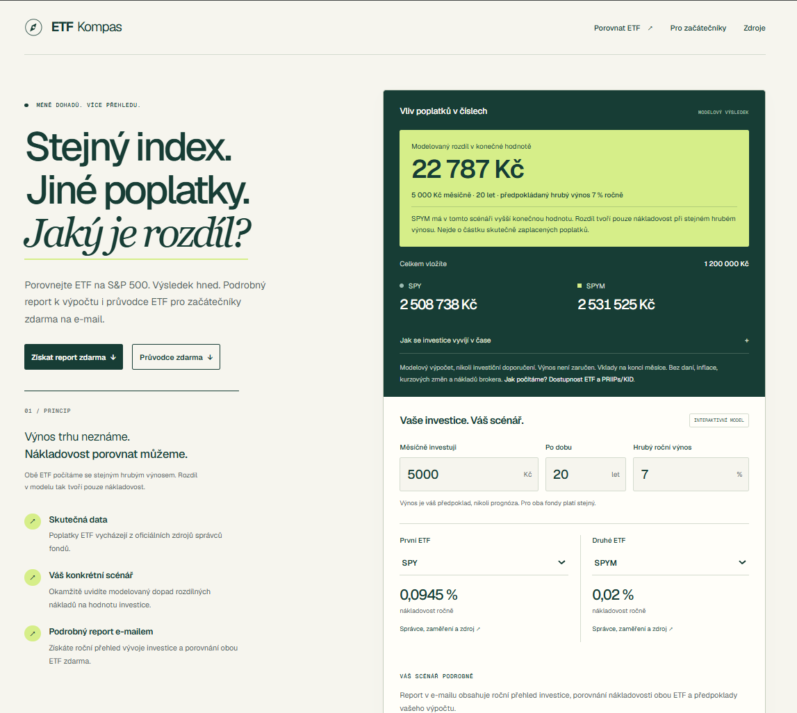
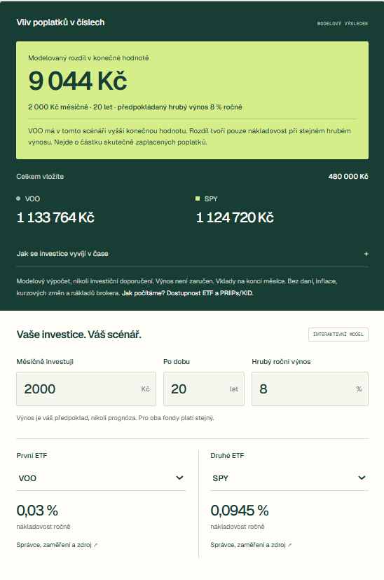
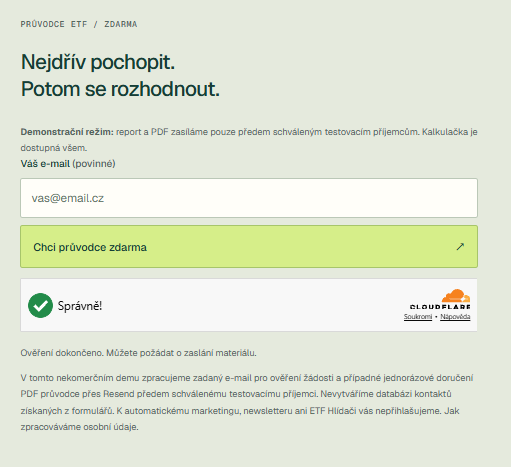
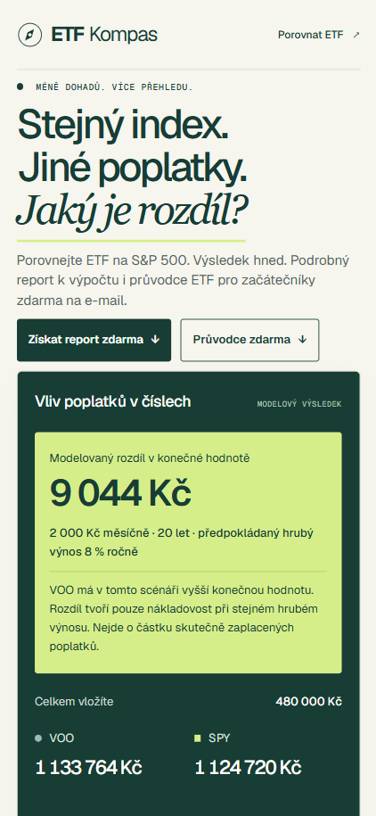

# ETF Kompas

ETF Kompas is a responsive educational web application that compares the modeled long-term impact of different ETF expense ratios. It helps Czech retail investors explore a concrete investment scenario, compare selected S&P 500 ETFs, and understand how costs may affect the final value over time.

The application is available in Czech and runs as a public, non-commercial portfolio demo.

**[Open the live application](https://etf-kompas-zeta.vercel.app/)** · **[Privacy information](https://etf-kompas-zeta.vercel.app/ochrana-osobnich-udaju)**



## Overview

ETF Kompas was originally created as a practical assignment during a developer recruitment process and was subsequently refined into an independent portfolio project.

The application demonstrates more than a client-side calculator. It combines a responsive React interface, a deterministic investment model, server-side validation and recalculation, protected email delivery, consent-based analytics, privacy documentation, and automated tests.

It is an educational comparison tool, not investment advice. The calculations use illustrative assumptions and do not predict future returns.

## Key features

- comparison of four S&P 500 ETFs: SPY, SPYM, VOO, and IVV;
- adjustable monthly contribution, investment horizon, and expected gross annual return;
- immediate comparison of modeled final values and cost impact;
- expandable annual results and calculation methodology;
- ETF data linked to official issuer sources;
- personalized HTML report sent by email;
- seven-page PDF guide for ETF beginners;
- responsive desktop and mobile interface;
- Czech privacy information and clear risk disclosures;
- optional Umami analytics loaded only after explicit consent.

## Screenshots

### Calculator and results



### Email materials



### Mobile layout



## Technology stack

### Application

- Next.js 16 with the App Router
- React 19
- TypeScript
- Tailwind CSS 4
- Node.js server-side route handlers

### Services and deployment

- Vercel for hosting and server functions
- Resend for transactional email delivery
- Cloudflare Turnstile for form protection
- Umami Cloud for consent-based analytics

### Development and verification

- Node.js built-in test runner
- ESLint
- TypeScript static checking
- Git and GitHub

## How it works

The calculator applies the same gross return assumption to both selected funds so that the modeled difference is caused only by their expense ratios. Contributions are added monthly, returns are reinvested, and the application produces annual data points for the selected horizon.

The browser displays the calculation immediately. When a user requests a personalized report, the server validates the submitted scenario and recalculates the result independently instead of trusting client-generated values.

ETF expense ratios are maintained as a manually verified snapshot, not a live market-data feed. The current dataset records its source and verification date for every fund.

## Email delivery and security

Both email flows use the same protected server-side delivery pipeline. The implementation includes:

- strict request and scenario validation;
- exact origin checks;
- Cloudflare Turnstile verification;
- a honeypot field;
- request size and content-type limits;
- request identity and provider idempotency;
- safe public error responses and restricted diagnostics;
- server-side recipient allowlisting;
- no email addresses, request bodies, tokens, or request IDs in application logs.

The project does not create a contact database, newsletter subscription, or marketing list.

## Demo limitations

The calculator is publicly available, but email delivery is intentionally restricted to two pre-approved test recipients. Requests for any other address are rejected before the material is prepared or passed to Resend.

The project is not a legally approved public financial service, and no advertising campaign has been run. Analytics events and conversion scenarios demonstrate the technical implementation; they are not evidence of measured campaign performance.

Before any broader or commercial use, the hosting plan, public email delivery, provider agreements, retention rules, privacy assessment, and financial communication would require a separate review.

## Local development

### Requirements

- Node.js 24.12 or newer
- npm
- Git

Install dependencies and start the development server:

```powershell
npm ci
npm run dev -- --webpack
```

Open [http://localhost:3000](http://localhost:3000).

The calculator works without external service configuration. Email delivery remains safely unavailable until all required environment variables are provided in `.env.local` or in the server environment:

```env
RESEND_API_KEY=
RESEND_FROM_EMAIL=
TURNSTILE_SECRET_KEY=
NEXT_PUBLIC_TURNSTILE_SITE_KEY=
APP_ORIGIN=http://localhost:3000
DEMO_ALLOWED_EMAILS=first@example.com,second@example.com
PRIVACY_CONTACT_EMAIL=
```

Never commit real credentials or approved recipient addresses. The two demo recipient addresses must be valid and different.

## Verification

Run the automated checks with:

```powershell
npm test
npm run lint
npx tsc --noEmit --incremental false
npm run build -- --webpack
```

Tests use mock configuration and mocked providers. They do not read `.env.local`, send real email, or transmit analytics events. The suite covers the investment model, validation, server-side recalculation, recipient restrictions, Turnstile integration contracts, idempotency, privacy rendering, consent behavior, analytics filtering, and form states.

The optional test against the real Umami tracker script is skipped unless a separately downloaded tracker fixture is explicitly supplied through `UMAMI_TRACKER_TEST_FILE`.

## Documentation

Detailed technical documentation:

- [ETF data and calculation model](docs/etf-data-and-model.md)
- [Email delivery and security](docs/email-delivery.md)
- [Analytics](docs/analytics.md)
- [Advertising and conversion plan](docs/ads-and-conversions.md)
- [Technical privacy review](docs/privacy-review.md)

The [`ai-log`](ai-log/README.md) directory remains in its original language because it documents the historical AI-assisted development process, major decisions, verification steps, and the boundary between generated assistance and human review.

## Project status

ETF Kompas is a completed portfolio and learning project maintained as a public demonstration. Its calculation, protected demo delivery flows, and automated checks are functional; the limitations described above are intentional and should not be interpreted as production readiness for a public financial or marketing service.

## License

The source code is available under the [MIT License](LICENSE). ETF names, issuer names, trademarks, source materials, and third-party services remain the property of their respective owners.
